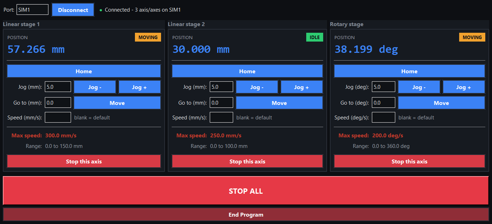

# Zaber Motion Stage Controller

A desktop control panel for Zaber linear and rotary motion stages, built in
Python with tkinter. Each axis gets Home, Jog, Go-to, a live position readout,
and a status pill, with a shared STOP ALL and per-axis stop.

This build runs against a software simulator, so it works with no hardware
attached. Connect and the axes move toward their targets in real time, the
position readouts count up, and the pills switch between MOVING and IDLE.

> This is a simulated stand-in for professional work I can't share publicly. It
> reuses the same control panel and the same hardware-abstraction approach,
> wired to a simulator instead of the real stages.



## Features

- One card per axis: Home, Jog by a set amount, Go to an absolute position, and an optional speed.
- Live position readout and a MOVING / IDLE / OFFLINE / ERROR status pill per axis.
- Linear axes read in mm, rotary in degrees, each with its own travel range and max speed.
- Out-of-range moves are refused with a clear message.
- STOP ALL (also bound to Esc) and a per-axis stop.

## How it's put together

```
stage_console.py   tkinter UI: axis cards, controls, polling
simulator.py       simulated stage controller and axes
```

The UI only talks to a small controller interface (connect, home, jog,
move_absolute, stop, position, is_busy). Swapping the simulator for a real
hardware layer that implements the same methods would drive actual stages with
no change to the UI.

## Run it

Python 3 with tkinter (included in standard Python installs):

```bash
python stage_console.py
```

Click Connect to bring the simulated stages online.

## Tech

Python · tkinter · ttk theming · timer-driven live readouts.
